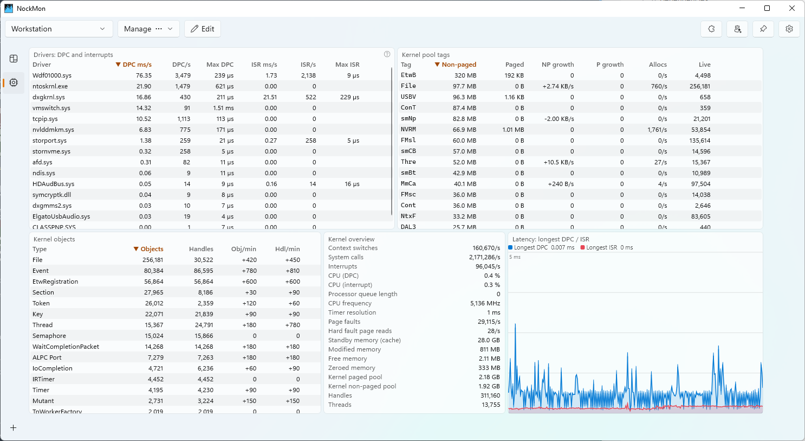

# NockMon

**A configurable, tile-based system monitor for Windows, for people who want to know what their machine is actually doing.**

CPU per logical processor, memory, disk, network and GPU, every process in detail, and the kernel itself: DPC and interrupt
latency per driver, kernel pool tags, kernel objects and handles. Everything is sampled continuously and kept for an
hour, so you can look at what happened *two minutes ago*, not only now. You build your own dashboards from widgets on
a grid, organize them in layouts and tabs, extend them with plugins, and let AI agents query the data or build
dashboards for you.


## Highlights

- **A board of widgets you arrange**: charts, values with sparklines, per-CPU and per-GPU-engine graphs, process tables,
  kernel tables. Drag to move, drag a corner to resize, stack several widgets in one spot.
- **Layouts and tabs**: one layout per task (gaming, build machine, server debugging), several pages per layout,
  switched in one click or with `Ctrl+Tab` / `Ctrl+1…9`.
- **History, not just "now"**: about an hour of history in memory, at 0.5 s resolution by default.
- **Deep diagnostics**: which driver causes audio crackles (longest DPC/ISR per driver), which pool tag leaks kernel
  memory, which object type leaks handles, which short-lived process keeps spawning, with its command line and exit code.
- **Any GPU**: engine load (3D, Compute, Copy, Video…) and memory for every vendor through the graphics kernel;
  temperature, power, fan and clocks on NVIDIA through NVML.
- **Compact mode**: no chrome, just the board. Double-click to toggle, drag anywhere to move. Pin it on top of everything.
- **Built-in help**: every widget, metric and column explains itself (hover or click the `?`), including how to read
  it and what high values mean.
- **Plugins**: widget kinds written in C# with the [NockMon SDK](docs/plugins.md), installed from nuget.org in the
  Plugins dialog.
- **AI agents (MCP)**: an opt-in [MCP server](docs/mcp.md) lets Claude Code, VS Code or any MCP client read the data
  ("why did my PC stutter 2 minutes ago?") and build dashboards that you review before they're saved.
- **Light on the machine**: native Windows APIs and a kernel event session; a full process scan costs about 13 ms.

<table>
<tr>
<td></td>
<td></td>
</tr>
<tr>
<td align="center"><em>Kernel page: drivers, pool tags, objects, latency</em></td>
<td align="center"><em>Compact mode</em></td>
</tr>
</table>

## Requirements

- **Windows 10 version 2004 (build 19041) or later, or Windows 11**, x64 or ARM64.
- **[.NET 10 SDK](https://dotnet.microsoft.com/download/dotnet/10.0)**, to install and run the `dotnet tool`.
- **Administrator rights.** NockMon asks for elevation (UAC) at start: the kernel event session (ETW), other users'
  processes, kernel pool and object statistics all require it.

The Windows App SDK is bundled: there is nothing else to install.

## Install

```powershell
dotnet tool install -g NockMon
```

Then start it from any terminal:

```powershell
nockmon
```

Update with `dotnet tool update -g NockMon`, remove with `dotnet tool uninstall -g NockMon`.

Running `nockmon` again while NockMon is running brings its window to the front (no second instance, no second UAC
prompt).

### Command line

| Command | What it does |
|---|---|
| `nockmon` | Starts NockMon (elevated), or shows the running instance. |
| `nockmon --plugin <folder>` | Also loads a plugin from a build output folder (plugin development). Repeatable. |
| `nockmon mcp` | MCP server over stdio for AI agents, relayed to the running instance. See [AI agents](docs/mcp.md). |

## Getting started

NockMon opens on a default layout. From there:

1. **Explore**: hover any widget title, column header or legend entry for what it shows; click a widget's `?` to pin
   its help.
2. **Edit**: click **Edit** in the toolbar. **Add widget** adds a widget at the first free spot; drag a widget to
   move it, drag its bottom-right corner to resize it, click its gear to configure it. **Done** saves, **Cancel**
   discards everything since you clicked Edit.
3. **Organize**: **Manage › New empty layout / Duplicate** for a new dashboard, **Manage › Add tab** for another page.
4. **Go compact**: double-click the board (or use the tray menu). Double-click again or press `Esc` to come back.


The [user guide](docs/user-guide.md) covers every feature: widgets, charts and their sources, stacks, tabs, compact
mode, the tray icon, settings and where files live.

## Widgets

| Widget | Shows |
|---|---|
| **Chart** | Time series of one or more metrics (system, one logical CPU, processes by name pattern, a kernel object type, a GPU), optionally stacked. |
| **Value** | One metric's latest value, large, over a sparkline. |
| **Value list** | Label / value rows for a list of metrics. |
| **Per-CPU graphs** | One small graph per logical processor: usage (kernel part shaded), user, kernel, DPC, interrupt time and rate, effective frequency. |
| **GPU engines** | One graph per GPU engine (3D, Compute, Copy, Video decode/encode…), filtered by name. |
| **Process table** | Top processes sorted by any process metric, optionally grouped by name and filtered. |
| **Process events** | Recent process starts and exits with command lines and exit codes, including processes too short-lived for any scan. |
| **Drivers (DPC/ISR)** | DPC and interrupt time, count and longest duration per driver. |
| **Kernel pool tags** | Paged and non-paged pool per allocation tag, with growth: finds leaking drivers. |
| **Kernel objects** | Live objects and handles per kernel object type, with growth: finds handle and object leaks. |
| **Stack** | Several widgets in one area, one shown at a time; navigate with arrows, dots or `Ctrl+wheel`, or auto-cycle. |
| **Plugin widgets** | Anything a [plugin](docs/plugins.md) provides. |

The [widget and metric reference](docs/widgets.md) lists every widget option and every metric.

## AI agents (MCP)

NockMon embeds an [MCP](https://modelcontextprotocol.io) server, **off by default**. Turn it on with the robot button in
the toolbar, then connect your agent. For Claude Code:

```powershell
claude mcp add nockmon -- nockmon mcp
```

Agents can then query the live state and the last hour of history ("what was using the disk at 14:32?", "is a driver
causing my latency spikes?", "does my server leak handles?"). With **Allow layout changes** on, they can also build
dashboards: their changes appear live in an edit session, and you click **Done** to keep them or **Cancel** to discard
them.

Access is local and per user, command lines are only shared if you allow it, and deleting a layout always asks you.
Setup for other clients, the tool list and the security model are in [AI agents](docs/mcp.md).

## Plugins

Plugins add widget kinds. Open **Plugins** in the toolbar to browse the plugins published on nuget.org (or your own
feeds and folders), install, update and uninstall them.

Writing one takes a class library, a package reference and two small classes: see the [plugin guide](docs/plugins.md).

> Plugins run inside NockMon, with administrator rights. Install only plugins whose author you trust.

## Documentation

| Page | Contents |
|---|---|
| [User guide](docs/user-guide.md) | Layouts, tabs, edit mode, charts, stacks, compact mode, tray, keyboard shortcuts, settings, files. |
| [Widgets and metrics](docs/widgets.md) | Every widget and its options; every system, CPU, process, GPU and kernel metric. |
| [AI agents (MCP)](docs/mcp.md) | Enabling, connecting clients, tools, security model, troubleshooting. |
| [Plugin development](docs/plugins.md) | The SDK, the development loop, packaging, publishing, API reference. |
| [Building from source](docs/building.md) | Building, testing, packaging the tool, repository layout. |

## Building from source

```powershell
git clone https://github.com/nockawa/NockMon.git
cd NockMon
dotnet build NockMon.slnx
dotnet test --solution NockMon.slnx
```

Details, packaging and the repository layout are in [Building from source](docs/building.md).

## Privacy

NockMon sends nothing anywhere. Everything it measures stays on your machine, in memory. The only network access is
the Plugins dialog (it lists and downloads packages from the sources you configure), and the MCP server is a local named
pipe, off unless you turn it on.
