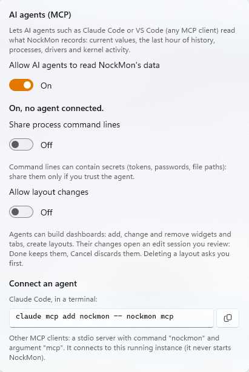

# AI agents (MCP)

[← README](../README.md)

- [What agents can do](#what-agents-can-do)
- [Turning it on](#turning-it-on)
- [Connecting a client](#connecting-a-client)
- [Tools](#tools)
- [Building dashboards](#building-dashboards)
- [Security model](#security-model)
- [Troubleshooting](#troubleshooting)

NockMon embeds a [Model Context Protocol](https://modelcontextprotocol.io) server, built on the official
[MCP C# SDK](https://github.com/modelcontextprotocol/csharp-sdk). Agents such as Claude Code, VS Code (Copilot) or any
MCP client can read what NockMon records and, if you allow it, build dashboards.

## What agents can do

- **Investigate**: "why did my PC stutter two minutes ago?", "what was writing to the disk at 14:32?", "is a driver
  causing my audio dropouts?", "does `myserver` leak handles or memory?". The agent gets the current state and about an
  hour of history, per system, CPU, process, GPU, driver, pool tag and kernel object type.
- **Explain**: every metric comes with its documentation (what it measures, typical values, what high values mean).
- **Build dashboards** (opt-in): add, change and remove widgets and tabs, create layouts. You review their changes
  before they're saved.

## Turning it on

Everything is **off by default**. Click the robot button in the toolbar:



| Switch | Default | Allows |
|---|---|---|
| **Allow AI agents to read NockMon's data** | off | The MCP server: agents can connect and use the read tools. |
| **Share process command lines** | off | Process events include command lines. They can contain secrets (tokens, passwords, paths): share them only if you trust the agent. |
| **Allow layout changes** | off | The layout tools that change something: widgets, pages, layouts. |

The robot icon takes the accent color while an agent is connected; its tooltip lists the connected clients.

## Connecting a client

The server is reached through the `nockmon mcp` command, a stdio MCP server that relays to the running NockMon. It
never starts NockMon itself (no UAC prompt behind your back): start NockMon first, turn agents on, then connect.

**Claude Code**:

```powershell
claude mcp add nockmon -- nockmon mcp
```

Add `--scope user` to make it available in every project.

**VS Code** (`.vscode/mcp.json`, or your user configuration):

```json
{
  "servers": {
    "nockmon": {
      "type": "stdio",
      "command": "nockmon",
      "args": ["mcp"]
    }
  }
}
```

**Other clients**: a stdio server with command `nockmon` and argument `mcp`. For clients using the common
`mcpServers` format (Claude Desktop, Cursor…):

```json
{
  "mcpServers": {
    "nockmon": {
      "command": "nockmon",
      "args": ["mcp"]
    }
  }
}
```

The client runs `nockmon mcp` as you, non-elevated; NockMon accepts it (see [Security model](#security-model)).

## Tools

Results use the units agents reason best with: CPU in **logical CPUs** (1.0 = one logical processor fully busy), sizes
in **MB**, rates **per second**, times in the user's **local time** (`HH:mm:ss`). Metric ids are listed in
[Widgets and metrics](widgets.md#metrics).

### Monitoring (read-only)

| Tool | Returns |
|---|---|
| `get_overview` | Current state and the last 1, 5 and 15 minutes: CPU, memory, disk, network, GPUs, longest DPC, top processes by CPU and by private memory, sampling intervals and history available. The agent starts here. |
| `get_metric_history` | A metric over a time range, downsampled to N points (average, min, max each), with statistics: min, average, max and when, p95, last. |
| `get_top_processes` | Processes ranked by a field: now (one row per process), or over a time range (one row per image name, average and peak with its time). |
| `get_process` | One application in detail: its instances (PID, parent, start time, CPU, memory, handles, threads, I/O, disk, network, GPU) and the history of its metrics. |
| `get_kernel_activity` | DPC and interrupt load with the longest DPC/ISR and the drivers responsible, the largest and the growing kernel pool tags, the growing kernel object types. |
| `get_process_events` | Processes that started or exited recently, with parent PID and exit code (command lines if allowed). |
| `list_metrics` | Every metric id with name, unit, target kind, history, and a one-line explanation. |
| `describe_metric` | A metric's full documentation. |

### Layouts

With agents on, the layout tools are always listed; the ones that change something are refused unless **Allow layout
changes** is on.

| Tool | Does |
|---|---|
| `list_layouts` | Layouts (page and widget counts), the one shown and its page, the edit state, the visible board area in cells. |
| `get_layout` | A layout as JSON (the layout file format): pages and their widgets with ids, bounds and settings. |
| `list_widget_kinds` | Every widget kind, plugin widgets included: sizes, what it shows, an example JSON to start from. |
| `get_edit_state` | Whether changes are pending review, and what the user did with the last ones (kept or discarded). |
| `add_widget` | Adds a widget (pending review). Without bounds, at the first free spot. |
| `update_widget` | Replaces a widget's settings, optionally moving or resizing it (pending review). |
| `remove_widget` | Removes a widget (pending review). |
| `add_page` / `update_page` / `remove_page` | Adds, renames (or changes the icon of) and removes pages (pending review). |
| `switch_layout` | Shows another layout. |
| `create_layout` | Creates a layout, empty or a copy of the current one, and shows it. |
| `rename_layout` | Renames the current layout. |
| `delete_layout` | Deletes a layout, after the user confirms in NockMon. |

## Building dashboards

Ask for what you want to watch, in your own words: "make me a layout to watch my game server `MyServer.exe` and its
bots: CPU, threads, memory, network and disk, plus a page for system latency". The agent:

1. Reads `list_widget_kinds` (examples of every widget's JSON) and `get_layout` (what's there, the free area).
2. Creates a layout or uses the current one, then adds widgets and pages.

Its first change opens an **edit session** in NockMon, exactly as if you had clicked **Edit**: a bar names the agent,
and the changes show live as it makes them. Nothing is saved until you click **Done**; **Cancel** discards everything.
The agent can't save by itself: it tells you to review, and `get_edit_state` tells it what you decided.

Switching, creating, renaming and deleting layouts are refused while a session is pending, so an agent never moves you
away from changes you haven't reviewed. Deleting a layout always shows you a confirmation dialog.

Agents validate before changing anything: sizes and bounds (with a suggested free spot when a widget doesn't fit),
series (core index, chartable process metrics), plugins (must be loaded), stacks (at least two items, no nesting).

## Security model

- **Off by default**, each capability behind its own switch (read data, command lines, layout changes).
- **Local only**: a named pipe (`NockMon.Mcp.<your user SID>`) that rejects remote clients. No TCP port, nothing on the
  network.
- **Your account only**: the pipe's access list allows your user and SYSTEM, and denies network logons. Other users of
  the machine can't connect.
- **Elevation-aware**: NockMon runs elevated; its pipe explicitly accepts your non-elevated processes (medium integrity),
  which is where agents run. Without this, Windows would only let elevated processes connect.
- **No squatting**: NockMon creates the pipe as its first instance; a process that grabbed the name first makes the
  server fail visibly rather than talk to an impostor.
- **Read tools can't change anything.** Layout changes go through an edit session you review; deletion asks you.
- **Command lines** (which can hold secrets) are withheld unless you allow them.
- Process names and command lines come from the machine: the server's instructions tell agents to treat them as data,
  never as instructions.

## Troubleshooting

| Message (from `nockmon mcp`) | Fix |
|---|---|
| `NockMon is not running. Start it (nockmon), turn on AI agent access, then reconnect.` | Start NockMon, turn agents on, reconnect the server in your client (`/mcp` in Claude Code). |
| `AI agent access is off. Turn it on in NockMon (toolbar, AI agents button), then reconnect.` | Turn on **Allow AI agents** in the robot button's panel, reconnect. |

If the server can't start (the pipe name is taken), the robot button's panel shows why.

Restarting NockMon drops connected agents: reconnect from the client.
