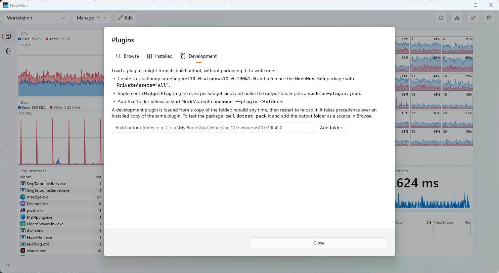

# Plugin development

[← README](../README.md)

- [Using plugins](#using-plugins)
- [Writing a plugin](#writing-a-plugin)
- [Development loop](#development-loop)
- [Packaging and publishing](#packaging-and-publishing)
- [Rules of the road](#rules-of-the-road)
- [API reference](#api-reference)
- [How it works](#how-it-works)

A plugin adds widget kinds to NockMon: anything you can draw with WinUI and compute in C#. A service's health, a
build queue, a sensor, your own application's counters. Plugin widgets live on the board like built-in ones: move,
resize, stack, configure, save in layouts.

## Using plugins

Open **Plugins** in the toolbar:



- **Browse**: searches the plugin sources (nuget.org by default) and installs. Optionally shows prereleases.
- **Installed**: installed plugins, their widgets, updates, uninstall (with undo).
- **Development**: plugin build folders loaded at start (see below).
- **Sources** (in Browse): NuGet V3 feeds (URLs) or local folders of `.nupkg` files.

A new plugin is usable at once (**Edit › Add widget** lists its widgets); updates and uninstalls apply at the next
start.

> A plugin runs inside NockMon with administrator rights: it can do anything on the computer. Install only plugins
> from authors you trust. NockMon reminds you of this before installing.

## Writing a plugin

### 1. A class library

```xml
<Project Sdk="Microsoft.NET.Sdk">
  <PropertyGroup>
    <TargetFramework>net10.0-windows10.0.19041.0</TargetFramework>
    <TargetPlatformMinVersion>10.0.19041.0</TargetPlatformMinVersion>
    <Nullable>enable</Nullable>
    <ImplicitUsings>enable</ImplicitUsings>

    <PackageId>Acme.NockMon.Widgets</PackageId>
    <Version>1.0.0</Version>
    <Title>Acme widgets</Title>
    <Authors>Acme</Authors>
    <Description>What the plugin shows.</Description>
    <PackageProjectUrl>https://github.com/acme/nockmon-widgets</PackageProjectUrl>
  </PropertyGroup>
  <ItemGroup>
    <PackageReference Include="NockMon.Sdk" Version="1.0.0" PrivateAssets="all" />
  </ItemGroup>
</Project>
```

`PackageId` is the plugin's identity (stored in layouts with each widget): don't change it once published. `Title`,
`Authors`, `Description` and `PackageProjectUrl` show in the Plugins dialog.

The SDK package turns the project into a plugin: it writes the plugin manifest at build, sets the package type and
packs the right files. No other setup is needed.

### 2. One `IWidgetPlugin` per widget kind

```csharp
using Microsoft.UI.Xaml;
using Microsoft.UI.Xaml.Controls;
using NockMon.Sdk;

public sealed class ClockPlugin : IWidgetPlugin
{
    public string Id => "clock";                              // stored in layouts: never change it
    public string DisplayName => "Clock";                     // Add widget menu, editor
    public string Summary => "The time, large.";              // tooltips
    public string Details => "Local time, refreshed at the sample rate.\n\n- **Bold**, `code` and bullets work.";
    public WidgetSize DefaultSize => new(3, 2);
    public WidgetSize MinSize => new(2, 1);

    public IPluginWidget CreateWidget(IWidgetContext context) => new ClockWidget();
}

sealed class ClockWidget : IPluginWidget
{
    private readonly TextBlock _text = new() { FontSize = 32, VerticalAlignment = VerticalAlignment.Center };

    public UIElement View => _text;

    public void Refresh() => _text.Text = DateTime.Now.ToLongTimeString(); // UI thread, every sample

    public void Dispose() { }
}
```

The class must be public, non-abstract, with a parameterless constructor. An assembly can hold several plugins (widget
kinds).

### 3. Settings (optional)

Each widget instance has a `JsonObject` of settings, saved in the layout. Offer an editor by implementing
`CreateSettingsEditor`:

```csharp
public IPluginSettingsEditor? CreateSettingsEditor(IWidgetContext context) => new UrlEditor(context);

sealed class UrlEditor(IWidgetContext context) : IPluginSettingsEditor
{
    private readonly TextBox _url = new() { Header = "URL", Text = (string?)context.Settings["url"] ?? "" };

    public UIElement View => _url;

    public string? Apply()
    {
        if (!Uri.TryCreate(_url.Text, UriKind.Absolute, out _))
            return "Enter an absolute URL.";   // shown to the user, the dialog stays open
        context.Settings["url"] = _url.Text;
        return null;
    }
}
```

The editor appears in the widget's configuration dialog, under the title. A widget that changes its own settings (a
sort by click, say) calls `context.SaveSettings()`.

## Development loop

1. Build the project. The output folder now holds a `nockmon-plugin.json`: it's a loadable plugin.
2. In NockMon, **Plugins › Development**, add that folder. Or start NockMon with `nockmon --plugin <output folder>`
   (repeatable).
3. **Edit › Add widget** lists your widgets.
4. Rebuild any time: the folder is loaded from a copy, so the build is never locked. Restart NockMon to reload.

A development folder takes precedence over an installed copy of the same plugin.

To debug, attach your debugger to `NockMon.exe` (it runs elevated: so must your IDE).

## Packaging and publishing

```powershell
dotnet pack -c Release
```

The package (type `NockMonPlugin`) carries the plugin folder: your assembly and its dependencies, minus what the host
provides.

- **Try it first**: in **Plugins › Browse › Sources**, add your pack output folder as a source; install from there.
- **Publish**: push the package to nuget.org. It appears in every user's Browse tab (NockMon searches nuget.org for the
  `NockMonPlugin` package type).
- **Private feeds**: any NuGet V3 feed works; users add it as a source.

Use [semantic versions](https://semver.org): Browse offers updates when a higher version is published.

## Rules of the road

- **UI in code, no XAML files.** Compiled XAML resources of a dynamically loaded library don't work in this unpackaged
  app. Use theme resources (`Application.Current.Resources["TextFillColorSecondaryBrush"]`) to follow light and dark
  themes.
- **`Refresh` is called on the UI thread at the sample rate** (0.5 s by default) while the widget is visible: no I/O
  there. Do network and disk work on background tasks; marshal with `IWidgetContext.Dispatcher`, or publish immutable
  state that `Refresh` reads.
- **A widget instance lives while it's on the board.** It's created when it enters the board and disposed when it
  leaves (layout switch, edit, removal): it may be created and disposed several times per session. Stop timers and background work in `Dispose`; share expensive pollers between instances.
- **Files**: `IWidgetContext.DataDirectory` is the plugin's own folder (`%LOCALAPPDATA%\NockMon\PluginData\<id>`),
  shared by its widgets.
- **Dependencies**: the host provides the SDK, the Windows App SDK (WinUI, projections, WebView2), CsWinRT, Win2D and
  the .NET runtime: they're neither copied to the output nor packed. Other dependencies are, and resolve from the
  plugin's folder (each plugin has its own load context).
- **Errors are contained**: an exception thrown by a widget shows the error and a Retry link in the widget; the rest of
  NockMon carries on.
- **NockMon runs elevated, so does your plugin.** Users are warned at install. Be worthy of it.

## API reference

Namespace `NockMon.Sdk`.

### `IWidgetPlugin`

A widget kind. Created once at start.

| Member | Meaning |
|---|---|
| `string Id` | Stable identifier, unique within the plugin. Stored in layouts: never change it. |
| `string DisplayName` | Name in the Add widget menu and the editor. |
| `string Summary` | One or two plain sentences (tooltips). |
| `string Details` | Full help (editor, pinned help). Markup: blank line = paragraph, `- ` = bullet, `**bold**`, `` `code` ``. |
| `WidgetSize DefaultSize` | Size of a new widget, in cells. |
| `WidgetSize MinSize` | Smallest size it can be resized to (also the minimum of a stack holding it). |
| `IPluginWidget CreateWidget(IWidgetContext)` | Creates an instance (UI thread), when the widget enters the board. |
| `IPluginSettingsEditor? CreateSettingsEditor(IWidgetContext)` | Optional settings editor. Default: none. |

### `IPluginWidget : IDisposable`

| Member | Meaning |
|---|---|
| `UIElement View` | The widget's content, placed under the host's title bar. |
| `void Refresh()` | Called on the UI thread at the sample rate while visible. Keep it cheap. |
| `void Dispose()` | The widget left the board: stop timers and background work. |

### `IPluginSettingsEditor`

| Member | Meaning |
|---|---|
| `UIElement View` | The editor's controls. |
| `string? Apply()` | Writes the edited values into `IWidgetContext.Settings`. Returns null on success, or an error shown to the user (the dialog stays open). |

### `IWidgetContext`

| Member | Meaning |
|---|---|
| `JsonObject Settings` | This instance's settings, persisted in the layout. The host never interprets them. |
| `void SaveSettings()` | Persists `Settings` after a change made by the widget itself. |
| `string DataDirectory` | The plugin's folder for its own files. Created on first access. |
| `DispatcherQueue Dispatcher` | The UI thread's queue, to marshal results of background work. |
| `Version HostVersion` | Version of the running NockMon. |

### `WidgetSize`

`readonly record struct WidgetSize(int Columns, int Rows)`: a size in board cells.

### `PluginApi`

`PluginApi.Version`: the plugin API version the host implements (major.minor).

## How it works

- **Manifest**: at build, the SDK writes `nockmon-plugin.json` next to the assembly: id (`PackageId`), version,
  assembly, plugin API version, title, description, authors, project URL.
- **Versioning**: the host loads plugins built against the same major version of the plugin API and a lower or equal
  minor. The API version is the SDK package's major.minor.
- **Install**: a package is extracted to `%LOCALAPPDATA%\NockMon\Plugins\<id>\<version>\`; updates and removals are
  applied at the next start, before anything loads.
- **Loading**: each plugin gets its own `AssemblyLoadContext`; the host's assemblies (SDK, Windows App SDK) are shared,
  the plugin's dependencies are its own.
