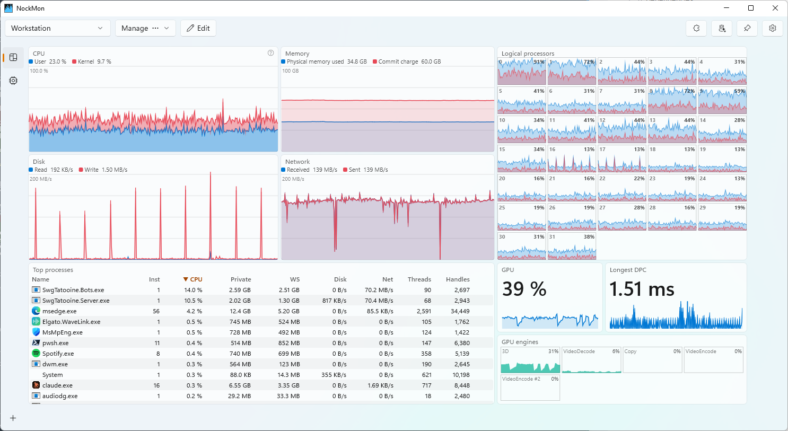
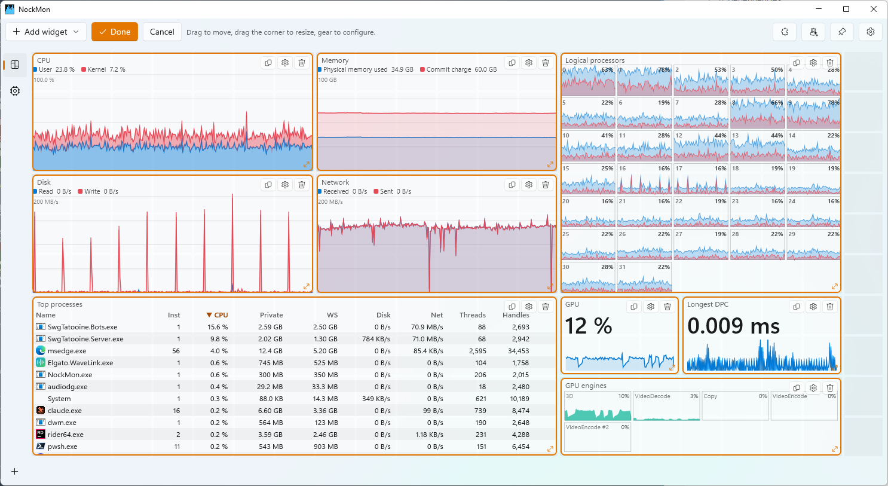
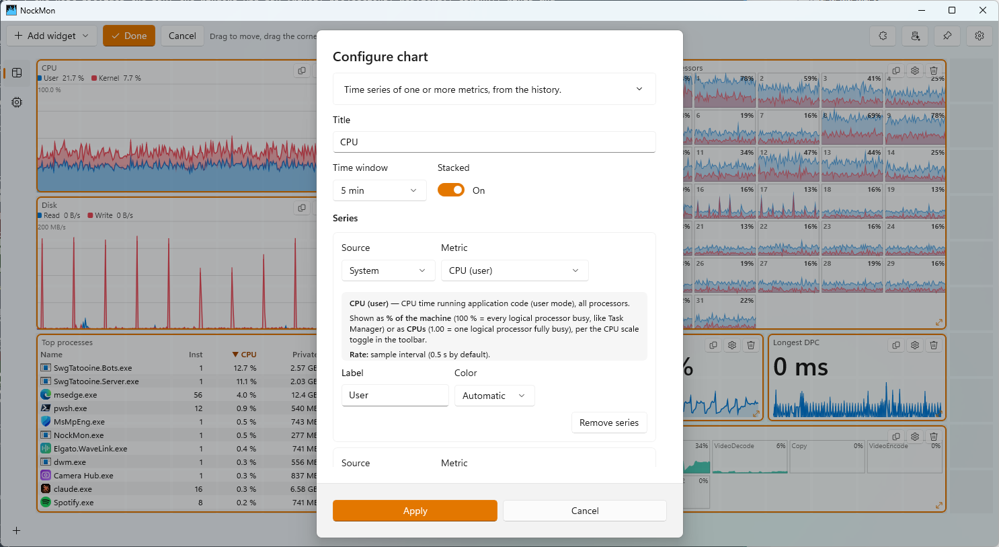
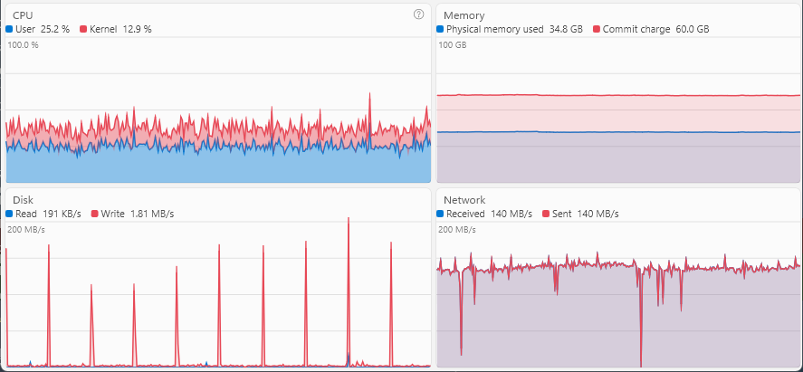

# User guide

[← README](../README.md)

- [The window](#the-window)
- [Layouts](#layouts)
- [Tabs (pages)](#tabs-pages)
- [Edit mode](#edit-mode)
- [Configuring widgets](#configuring-widgets)
- [Stacks](#stacks)
- [Compact mode](#compact-mode)
- [Tray icon and window behavior](#tray-icon-and-window-behavior)
- [Keyboard and mouse](#keyboard-and-mouse)
- [Settings](#settings)
- [Kernel events (ETW)](#kernel-events-etw)
- [Files](#files)

## The window

The toolbar, left to right:

- **Layout picker**: the layout shown. Switching is instant; each layout remembers the tab it was on.
- **Manage**: new empty layout, duplicate, rename, add a tab, delete.
- **Edit**: enters edit mode (move, resize, add and remove widgets).
- **Plugins**: browse, install, update and develop [plugins](plugins.md).
- **AI agents**: the [MCP server](mcp.md) switches and how to connect an agent. The icon takes the accent color while an
  agent is connected.
- **Always on top**: keeps the window above other windows.
- **Settings**: CPU display, sample and scan intervals (see [Settings](#settings)).

Below the toolbar, the board: a grid of square cells (64 px plus a 4 px gap by default) that widgets snap to. The board
fills the window; widgets beyond the visible area are hidden until the window is large enough to show them.

Every widget explains itself: hover its title for a summary, click its `?` button to pin its full help. Column headers,
legend entries, value list labels and metric pickers have tooltips with the metric's meaning.

## Layouts

A layout is a named dashboard: its tabs, their widgets and the board settings. Make one per use: a gaming overlay, a
build machine view, a dashboard for the server you're debugging.

**Manage** menu:

| Item | Does |
|---|---|
| New empty layout… | Creates an empty layout and shows it. |
| Duplicate… | Copies the current layout under a new name. |
| Rename… | Renames the current layout. |
| Add tab… | Adds a page to the current layout. |
| Delete… | Deletes the current layout (after confirmation). |

Each layout is a JSON file in the `Layouts` folder (see [Files](#files)): you can back them up, copy them to another
machine, or share them. A layout that refers to a missing plugin keeps that widget's settings and shows what to
install.

## Tabs (pages)

A layout can have several pages. With more than one, a rail of icons appears on the left of the board (in edit mode it
is always shown, with a **+** to add a page).

- Click an icon, or use `Ctrl+Tab` / `Ctrl+Shift+Tab` / `Ctrl+1…9`, to switch pages.
- Hover an icon for the page name.
- Right-click an icon to **rename** it, **change its icon** (a searchable picker over the ~2900 Fluent UI System
  Icons), **duplicate**, **move** or **delete** it.
- Drag icons to reorder pages.
- In edit mode, drop a widget on a tab to move it to that page.

## Edit mode

Click **Edit**. The toolbar switches to **Add widget**, **Done** and **Cancel**, and each widget gets handles:

- **Drag** a widget to move it. Widgets snap to the grid and can't overlap.
- **Drag the bottom-right corner** to resize. Each widget kind has a minimum size.
- **Gear**: configure the widget (see below).
- **Clone**: duplicates the widget into the first free spot.
- **Remove**: removes the widget.
- **Drop a widget onto another** to [stack](#stacks) them.
- **Add widget** lists every widget kind, plugin widgets included; the new widget goes to the first free spot.

**Done** saves the layout; **Cancel** reverts every change made since you clicked **Edit**. Layout management
(switching, creating, deleting layouts) waits until you leave edit mode.

When an AI agent changes a layout, NockMon enters edit mode the same way and shows which agent is editing: you review
its changes live and decide with **Done** or **Cancel**.

## Configuring widgets

The gear opens the widget's editor: a title (leave it empty for an automatic one), then the options of its kind. The
editor starts with the widget's documentation, and every metric picker explains the metric selected.

### Charts and values: series

Charts, values and value lists show *series*. A series is a metric of a source:

| Source | Target | Examples |
|---|---|---|
| **System** | the whole machine | CPU, memory, disk, network, DPC/ISR, context switches |
| **Logical CPU** | one logical processor, by index | usage, kernel time, frequency of CPU 5 |
| **Processes** | every process whose image name matches a pattern, summed | CPU of `chrome`, working set of `devenv;msbuild` |
| **Kernel object** | an object type | `Token` objects, `File` handles |
| **GPU** | an adapter | utilization, an engine (`Compute*`), dedicated memory, temperature |

All series of a chart must share a unit (you can't mix bytes and percents). A chart can be **stacked**, for parts of a
whole: user plus kernel CPU, or several processes. Each series can have its own label and color.

**Name patterns** (process series, filters): `*` and `?` wildcards, `;` between alternatives, case-insensitive. A name
without a wildcard also matches with `.exe`: `devenv; chrome*` matches `devenv.exe` and every `chrome…` process.

NockMon records the chartable metrics of every process, per image name, at the process scan rate (2 s): a chart you
add now already shows the past hour of the processes you pick. From then on, the processes it uses are *watched*:
NockMon keeps a handle on every matching process and samples them at the fast rate (0.5 s). A process series sums
whatever matching instances exist at each moment, so it keeps going across restarts of the application.

See [Widgets and metrics](widgets.md) for every option and metric.

## Stacks

A stack holds several widgets in the same area and shows one at a time: a gauge cycling through disk, network and GPU,
or alternative views of the same thing.

- **Create**: in edit mode, drop a widget onto another.
- **Navigate**: the edge arrows, the dots, the mouse wheel over the dots or arrows, or `Ctrl+wheel` anywhere on the
  stack.
- **Auto-cycle**: set an interval in the stack's editor; cycling pauses while the pointer is over the stack.
- **Unstack**: in edit mode, the unstack button moves the shown widget out to a free spot.
- The stack's editor reorders, removes and edits its items.

## Compact mode

Compact mode hides the toolbar, the title bar and the tab rail: only the board remains, in a resizable border. It's
made for a small always-on-top monitor in a corner of the screen.

- **Enter / leave**: double-click the board, or **Compact mode** in the tray menu. `Esc` also leaves.
- **Move**: drag the window from anywhere on the board.
- **Switch pages**: `Ctrl+Tab` / `Ctrl+1…9` still work.
- Normal and compact mode each remember their own window position and size. The first time, compact mode keeps the
  window where it is.

## Tray icon and window behavior

NockMon has a notification area icon. Its menu:

| Item | Does |
|---|---|
| Show | Brings the window back. |
| Always on top | Same as the toolbar button. |
| Compact mode | Toggles compact mode. |
| Close button hides to tray | When checked, closing the window hides it; NockMon keeps sampling. |
| Exit | Quits NockMon. |

NockMon is single-instance: starting it again (`nockmon`, a shortcut) shows the running window instead.

The window position, size and maximized state are restored at start.

## Keyboard and mouse

| Input | Action |
|---|---|
| `Ctrl+Tab` / `Ctrl+Shift+Tab` | Next / previous page |
| `Ctrl+1` … `Ctrl+9` | Page 1 to 9 |
| Double-click the board | Toggle compact mode (outside edit mode) |
| `Esc` | Leave compact mode |
| Drag the board (compact mode) | Move the window |
| `Ctrl+wheel` over a stack | Previous / next widget of the stack |
| Click a table column header | Sort by it; click again to reverse |

## Settings

The toolbar's gear:

| Setting | Values | Meaning |
|---|---|---|
| **CPU values** | % of total, Logical CPUs used | `% of total`: 100 % = every logical processor busy (like Task Manager). `Logical CPUs`: 1.00 = one logical processor fully busy, the natural unit to spot a single-threaded bottleneck. |
| **Sample interval** | 250 ms to 5 s (default 500 ms) | System metrics, per-CPU graphs and watched processes. |
| **Process scan interval** | 1 to 10 s (default 2 s) | Full process scan: process tables and the history of unwatched processes. |

Changing an interval clears the history.

A few more settings live only in `settings.json` (edit it while NockMon is closed):

| Key | Default | Meaning |
|---|---|---|
| `historyMinutes` | `60` | How much history is kept, in minutes. Memory grows with it. |
| `closeToTray` | `true` | Same as the tray menu item. |
| `pluginSources` | nuget.org | Feeds and folders the Plugins dialog lists. |

## Kernel events (ETW)

Drivers, DPC/ISR latency, process events, per-process disk and network, and system disk and network throughput come
from a kernel event tracing (ETW) session. It needs administrator rights. NockMon uses a private session
(`NockMon-Kernel`), so it doesn't conflict with xperf, Process Monitor or other tools using the "NT Kernel Logger".

If the session can't start, a bar under the toolbar says why, and the affected widgets stay empty. Under very heavy
load the trace buffers can overflow: the same bar reports lost events, as the affected values may be under-reported for
that time.

## Files

Everything lives in `%LOCALAPPDATA%\NockMon`:

| Path | Contents |
|---|---|
| `settings.json` | Settings, window placements, the active layout. |
| `Layouts\<name>.json` | One file per layout. |
| `Plugins\` | Installed plugins, one folder per plugin and version. |
| `PluginData\<plugin id>\` | Plugins' own files (caches, state). |

Files are written atomically (a crash never leaves a truncated file). The history is kept in memory only.

The environment variable `NOCKMON_DATA_DIR` points NockMon at another folder: handy for testing layouts or keeping
separate profiles.
