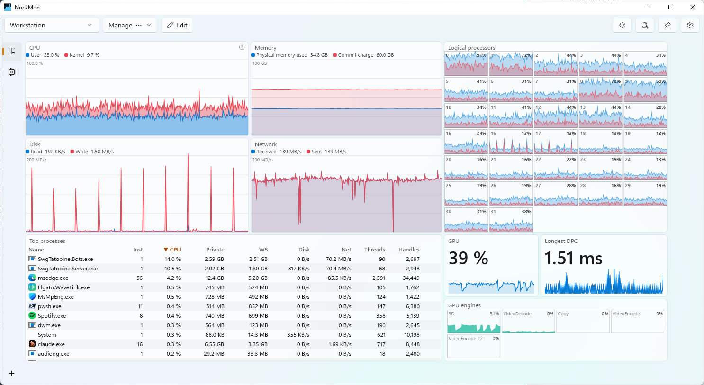

# NockMon

A configurable, tile-based system monitor for Windows, for people who want to know what their machine is actually doing.

CPU per logical processor, memory, disk, network and GPU, every process in detail, and the kernel itself: DPC and interrupt
latency per driver, kernel pool tags, kernel objects and handles. Everything is sampled continuously and kept for an
hour. You build your own dashboards from widgets on a grid, organize them in layouts and tabs, extend them with plugins,
and let AI agents query the data or build dashboards for you (MCP).



## Install and run

This package is NockMon's command line. The app itself runs as administrator, so it installs in Program Files, where
non-administrators cannot modify it:

```powershell
winget install Nockawa.NockMon
dotnet tool install -g NockMon   # Optional: the nockmon command, for AI agents (MCP) and the terminal.
nockmon
```

Requires Windows 10 2004 (19041) or later, x64 or ARM64.

| Command | What it does |
|---|---|
| `nockmon` | Starts the installed NockMon, or shows the running instance. |
| `nockmon --plugin <folder>` | Also loads a plugin from a build output folder (plugin development; NockMon asks you to confirm). |
| `nockmon mcp` | MCP server over stdio for AI agents, relayed to the running instance (off until enabled in the app). |

Up to 1.1, this package carried the app itself. Since 1.2 it does not: install NockMon with winget or its installer.

## Documentation

- [README and screenshots](https://github.com/nockawa/NockMon)
- [User guide](https://github.com/nockawa/NockMon/blob/main/docs/user-guide.md)
- [Widgets and metrics](https://github.com/nockawa/NockMon/blob/main/docs/widgets.md)
- [AI agents (MCP)](https://github.com/nockawa/NockMon/blob/main/docs/mcp.md)
- [Plugin development](https://github.com/nockawa/NockMon/blob/main/docs/plugins.md) (package `NockMon.Sdk`)
